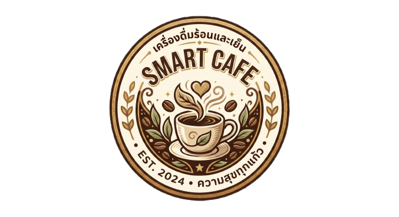
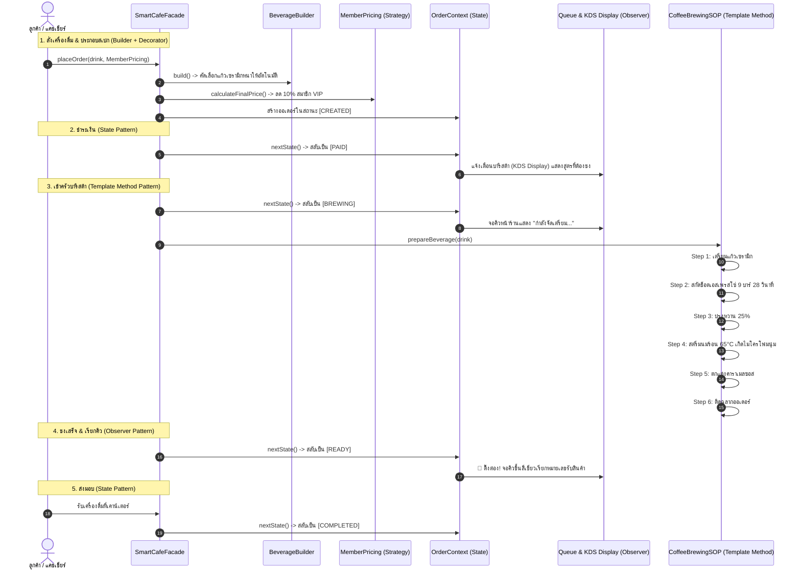

<div align="center">
  
  <h1>☕ SMART CAFE SYSTEM (ระบบร้านขายเครื่องดื่มอัจฉริยะ)</h1>
  <p><strong>เครื่องดื่มร้อนและเย็น • ความสุขทุกแก้ว • EST. 2024</strong></p>
  <p><em>การออกแบบเชิงสถาปัตยกรรมด้วยแบบแผน GoF Design Patterns ที่เหมาะสมที่สุดกับแต่ละระบบในร้าน</em></p>
  <p>> <em>"ไม่ใช้ Pattern เดียวครอบจักรวาล แต่วิเคราะห์ว่าในระบบร้าน ระบบไหนเหมาะกับ Pattern ไหนมากที่สุด"</em></p>
</div>

---

## 📌 1. บทนำและแนวคิดการออกแบบ (Architecture Concept)

ในโลกแห่งความเป็นจริง ระบบการทำงานของร้านขายเครื่องดื่ม (Cafe & Beverage System) ไม่ได้มีเพียงหน้าที่เดียว แต่ประกอบด้วยระบบย่อย (Subsystems) ที่มีลักษณะการทำงาน วงจรชีวิต และความต้องการทางเทคนิคที่แตกต่างกันอย่างสิ้นเชิง 

การพยายามนำ Design Pattern เพียงแบบแผนเดียวมาครอบคลุมทั้งร้าน จะเกิดข้อจำกัดและไม่สะท้อนโครงสร้างที่แท้จริง ดังนั้น สถาปัตยกรรมของโครงการนี้จึงได้รับการออกแบบโดย **จับคู่ Design Pattern ที่เหมาะสมที่สุดเข้ากับแต่ละระบบย่อยในร้านโดยเฉพาะ**:

```
+---------------------------------------------------------------------------------------------------------+
|                                    🏛️ SMART CAFE SYSTEM ARCHITECTURE                                   |
+---------------------------------------------------------------------------------------------------------+
|  1. ระบบเครื่องดื่ม & ท็อปปิ้ง     ──▶  🎨 DECORATOR PATTERN        (ขยายท็อปปิ้ง/คำนวณราคาสะสมตาม OCP)  |
|  2. ระบบประกอบสเปก & เลือกแก้ว    ──▶  🔨 BUILDER PATTERN          (ประกอบสเปกหลายมิติ + เลือกแก้วอัตโนมัติ) |
|  3. ระบบคิดราคา & ส่วนลด          ──▶  💡 STRATEGY PATTERN         (สลับนโยบายราคา VIP/Eco/Student ที่ Runtime) |
|  4. ระบบวงจรชีวิตสถานะออเดอร์     ──▶  🔄 STATE PATTERN            (Created -> Paid -> Brewing -> Ready)   |
|  5. ระบบแจ้งเตือนคิว & ครัว       ──▶  📢 OBSERVER PATTERN         (กระจายข้อมูลคิวหน้าร้าน & KDS แบบ Loose)   |
|  6. ระบบขั้นตอนการชงมาตรฐาน SOP  ──▶  ☕ TEMPLATE METHOD PATTERN  (โครงสร้างชง 6 สเต็ปมาตรฐานของบาริสต้า)  |
|  7. ระบบเคาน์เตอร์บริการเบ็ดเสร็จ  ──▶  🏛️ FACADE PATTERN          (รวมศูนย์ทุกระบบไว้ใน API จุดเดียว)        |
+---------------------------------------------------------------------------------------------------------+
```

---

## 🏆 2. การจัดสรร Pattern ให้เหมาะสมกับแต่ละระบบในร้าน (Subsystem Mapping)

| ระบบย่อยในร้าน (Subsystem) | ปัญหาและความต้องการเฉพาะ | Design Pattern ที่เหมาะสมที่สุด | เหตุผลทางวิศวกรรมซอฟต์แวร์ |
| :--- | :--- | :--- | :--- |
| **1. ระบบเครื่องดื่มและส่วนผสมเสริม**<br>*(Beverage & Toppings)* | ลูกค้าต้องการเพิ่ม Toppings (ไข่มุก, ว่านหางจระเข้, วิปครีม, เพิ่มช็อต) ได้อิสระหลายชั้น และต้องคิดราคาสะสมอย่างถูกต้อง | **🎨 Decorator Pattern** | ห่อหุ้ม `BaseBeverage` ด้วย `ToppingDecorator` ทีละชั้น ซ้อนทับได้ไม่รู้จบ คำนวณราคาสะสมแบบ Dynamic ตามหลัก **Open-Closed Principle (OCP)** เพิ่มท็อปปิ้งใหม่ได้โดยไม่ต้องแก้คลาสเดิม |
| **2. ระบบประกอบสเปก & คัดเลือกแก้ว**<br>*(Order Construction & Cup Matcher)* | เครื่องดื่มมีตัวเลือกซับซ้อน 10+ มิติ (หมวดหมู่, ขนาด S/M/L/XL, หวาน 0-120%, เปรี้ยว 0-100%, น้ำแข็ง, ทานที่ร้าน/กลับบ้าน) และต้องเลือกแก้วที่เหมาะสม | **🔨 Builder Pattern** | แยกการประกอบวัตถุเป็นขั้นตอนด้วย Fluent API ป้องกัน **Telescoping Constructor Anti-Pattern** และฝังอัลกอริทึมเลือกภาชนะ/แก้วที่เหมาะสมตามสเปกอัตโนมัติในตัว |
| **3. ระบบคิดราคา ส่วนลด และโปรโมชัน**<br>*(Pricing & Promotions)* | ร้านมีโปรโมชันและกลุ่มลูกค้าที่หลากหลาย (ราคาปกติ, สมาชิก VIP ลด 10%, นำแก้วมาเองลด 10฿, บัตรนักศึกษาลด 15%) | **💡 Strategy Pattern** | แยกอัลกอริทึมการคิดราคาออกจากตัวเครื่องดื่ม สามารถสลับสับเปลี่ยนกลยุทธ์คิดราคาได้ทันทีที่ Runtime โดยไม่ต้องเขียน if-else ซับซ้อน |
| **4. ระบบจัดการวงจรชีวิตออเดอร์**<br>*(Order Lifecycle Management)* | ออเดอร์มีสถานะที่เปลี่ยนไปตามลำดับ (รอจ่าย -> จ่ายแล้ว -> กำลังชง -> พร้อมรับ -> ส่งมอบ) แต่ละสถานะมีข้อจำกัด เช่น ชงอยู่ห้ามยกเลิก | **🔄 State Pattern** | จัดการพฤติกรรมตามสถานะผ่านคลาส State เฉพาะตัว ป้องกันการทำงานผิดขั้นตอน และขจัดเงื่อนไขตรวจสอบสถานะที่กระจัดกระจาย |
| **5. ระบบแจ้งเตือนคิวหน้าร้านและในครัว**<br>*(Queue & Kitchen Notification)* | เมื่อสถานะออเดอร์เปลี่ยน ต้องแจ้งเตือนจอเรียกคิวลูกค้า จอบาริสต้าในครัว (KDS) และระบบบันทึก Audit Log พร้อมกัน | **📢 Observer Pattern** | ออกแบบการสื่อสารแบบ **Publish-Subscribe (Loose Coupling)** ตัวสั่งออเดอร์ไม่ต้องรู้จักหน้าจอ ขอเพียงแจ้งเหตุการณ์ผ่าน Subject/Bus |
| **6. ระบบขั้นตอนและสูตรมาตรฐานการชง**<br>*(SOP Brewing Workflow)* | เครื่องดื่มทุกแก้วต้องชงผ่าน SOP มาตรฐาน 6 ขั้นตอนเหมือนกัน แต่ขั้นตอนสกัดเบสและจัดการอุณหภูมิต่างกันตามประเภท | **☕ Template Method Pattern** | กำหนดกระดูกงูขั้นตอนตายตัวใน Abstract Class (`prepareBeverage()`) แล้วให้คลาสลูก (`CoffeeSOP`, `TeaSOP`, `SmoothieSOP`) ไป override เฉพาะขั้นตอนสกัด |
| **7. ระบบเคาน์เตอร์แคชเชียร์รวมศูนย์**<br>*(Cashier & POS Service)* | หน้าบ้าน (แคชเชียร์, Kiosk, WebApp) ต้องการสั่งงานง่ายๆ ไม่อยากประสานงานกับทั้ง 6 ระบบด้วยตนเอง | **🏛️ Facade Pattern** | รวมความซับซ้อนของทั้งระบบไว้เบื้องหลัง `SmartCafeFacade` เรียกใช้เพียงคำสั่งเดียว เช่น `processFullOrderFlow()` |

---

## 🏛️ 3. แผนผังความสัมพันธ์ของสถาปัตยกรรม (Architecture Class Diagram)

```mermaid
classDiagram
    %% Facade
    class SmartCafeFacade {
        +placeOrder(Beverage, PricingStrategy) Order
        +processPayment(String orderId)
        +startBrewing(String orderId)
        +finishBrewing(String orderId)
        +serveCustomer(String orderId)
        +processFullOrderFlow(...)
    }

    %% Builder Pattern
    class BeverageBuilder {
        +setName(String) BeverageBuilder
        +setSize(BeverageSize) BeverageBuilder
        +setTemperature(Temperature) BeverageBuilder
        +setDiningOption(DiningOption) BeverageBuilder
        +setSweetness(SweetnessLevel) BeverageBuilder
        +setSourness(SournessLevel) BeverageBuilder
        +addTopping(ToppingType) BeverageBuilder
        +build() Beverage
        -determineOptimalCup() CupType
    }

    %% Decorator Pattern
    class Beverage {
        <<interface>>
        +getName() String
        +getDescription() String
        +getCost() double
        +getIngredients() List~String~
    }
    class BaseBeverage {
        +getCost() double
        +getDescription() String
    }
    class BeverageDecorator {
        <<abstract>>
        #wrappedBeverage Beverage
    }
    class ToppingDecorator {
        -topping ToppingType
        +getCost() double
        +getDescription() String
    }

    %% Strategy Pattern
    class PricingStrategy {
        <<interface>>
        +calculateFinalPrice(Beverage) double
    }
    class RegularPricing
    class MemberPricing
    class EcoCupPricing
    class StudentPricing

    %% State Pattern
    class OrderState {
        <<interface>>
        +next(OrderContext)
        +cancel(OrderContext)
    }
    class CreatedState
    class PaidState
    class BrewingState
    class ReadyState
    class CompletedState

    %% Observer Pattern
    class OrderObserver {
        <<interface>>
        +onOrderStatusChanged(OrderContext, String)
    }
    class CustomerQueueDisplay
    class BaristaKitchenDisplay
    class ManagerAuditNotifier

    %% Template Method Pattern
    class BrewingSOPTemplate {
        <<abstract>>
        +prepareBeverage(Beverage)*
        #selectAndSanitizeCup(Beverage)
        #extractBase(Beverage)*
        #tuneSweetnessAndSourness(Beverage)
        #handleTemperature(Beverage)*
        #addToppingsAndGarnish(Beverage)
        #sealAndAttachOrderLabel(Beverage)
    }
    class CoffeeBrewingSOP
    class TeaBrewingSOP
    class SmoothieBrewingSOP

    %% Relationships
    SmartCafeFacade ..> BeverageBuilder : สร้างเครื่องดื่ม
    SmartCafeFacade ..> PricingStrategy : คำนวณส่วนลด
    SmartCafeFacade ..> BrewingSOPTemplate : ควบคุมการชง SOP

    Beverage <|.. BaseBeverage : implements
    Beverage <|.. BeverageDecorator : implements
    BeverageDecorator <|-- ToppingDecorator : extends
    BeverageDecorator o-- Beverage : wraps

    PricingStrategy <|.. RegularPricing : implements
    PricingStrategy <|.. MemberPricing : implements
    PricingStrategy <|.. EcoCupPricing : implements
    PricingStrategy <|.. StudentPricing : implements

    OrderState <|.. CreatedState : implements
    OrderState <|.. PaidState : implements
    OrderState <|.. BrewingState : implements
    OrderState <|.. ReadyState : implements
    OrderState <|.. CompletedState : implements

    OrderObserver <|.. CustomerQueueDisplay : implements
    OrderObserver <|.. BaristaKitchenDisplay : implements
    OrderObserver <|.. ManagerAuditNotifier : implements

    BrewingSOPTemplate <|-- CoffeeBrewingSOP : extends
    BrewingSOPTemplate <|-- TeaBrewingSOP : extends
    BrewingSOPTemplate <|-- SmoothieBrewingSOP : extends
```



---

## 🔄 4. ตัวอย่างการทำงานจริงแบบครบวงจร (Live Order Simulation Flow)



---

## 💻 5. วิธีการคอมไพล์และทดสอบรัน (Running the Project)

### 5.1 รันโปรแกรม Java Console:
```powershell
# คอมไพล์โปรเจกต์ Java ทั้งหมด
javac -encoding UTF-8 -d bin (Get-ChildItem -Recurse -Filter *.java src | ForEach-Object { $_.FullName })

# รันโปรแกรมหลัก
java "-Dfile.encoding=UTF-8" -cp bin smartcafe.Main
```

### 5.2 รัน Modern Web Application (Kiosk, KDS & Queue Board):
```powershell
# เข้าสู่โฟลเดอร์ webapp
cd webapp

# ติดตั้ง dependencies (หากยังไม่ได้ติดตั้ง)
npm install

# รัน Local Development Server
npm run dev
# เปิดเบราว์เซอร์ที่: http://localhost:5173/
```

---

## 🌟 6. สรุปคุณค่าของสถาปัตยกรรม (Architectural Summary)

การจัดสรร Design Patterns ให้ตรงกับธรรมชาติของแต่ละระบบในร้านส่งผลดีอย่างยิ่ง:
1. **High Cohesion & Low Coupling**: แต่ละระบบมีหน้าที่รับผิดชอบชัดเจน (Single Responsibility Principle)
2. **Extensibility**: ต้องการเพิ่ม Topping ใหม่? -> สร้าง `ToppingDecorator` ใหม่, ต้องการเพิ่มส่วนลดใหม่? -> สร้าง `PricingStrategy` ใหม่, ต้องการเพิ่มหมวดหมู่เครื่องดื่มใหม่? -> สร้าง `BrewingSOPTemplate` ใหม่ โดยไม่กระทบโค้ดเดิม (Open-Closed Principle)
3. **Robustness & Cleanliness**: วงจรชีวิตของออเดอร์ถูกควบคุมด้วย State Pattern อย่างปลอดภัย ปราศจากบั๊กจากการเปลี่ยนสถานะผิดลำดับ
4. **Intuitive Usability**: หน้าร้านและผู้ใช้งานเรียกผ่าน Facade ได้ง่ายเพียงจุดเดียว
